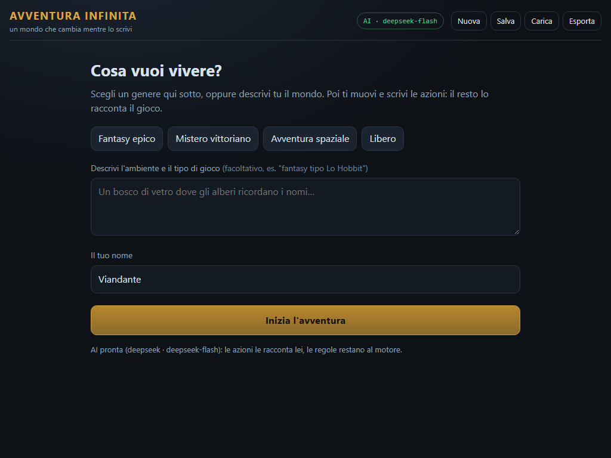
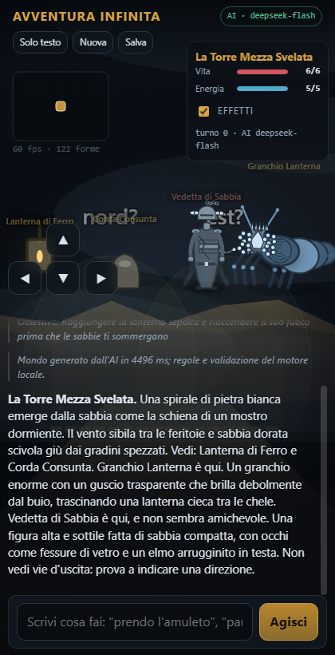
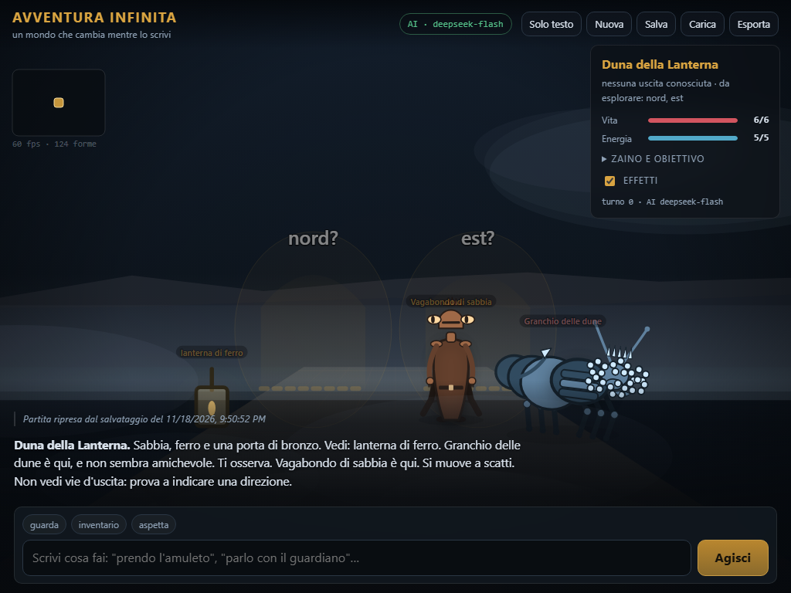
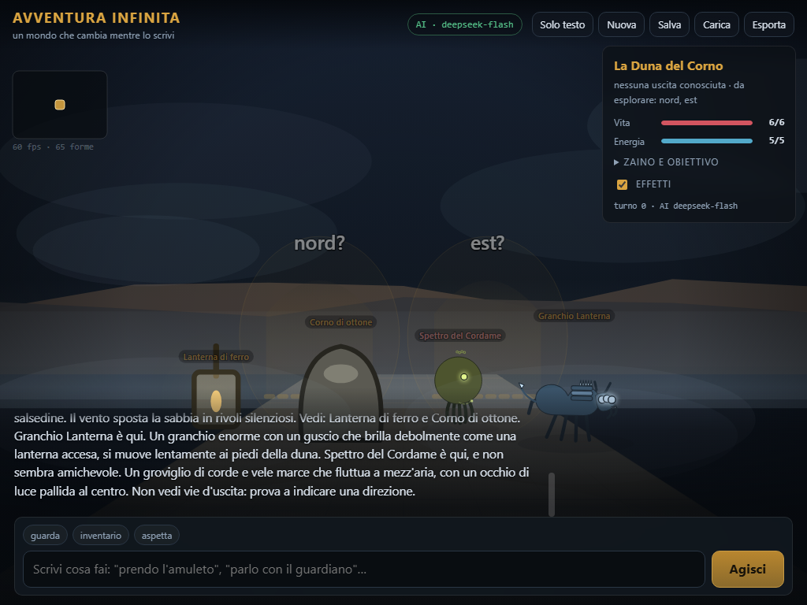

# Avventura Infinita

Avventura **con scena in prima persona**: scrivi la scena di partenza e **l'AI inventa il mondo**
(titolo, atmosfera, primo luogo, oggetti, creature) e genera gli SVG che vengono mostrati. Poi ti
muovi e scrivi quello che fai: l'AI racconta e allarga il mondo, mentre un motore locale tiene i conti
e valida le regole. Non ci sono mondi preconfezionati né generi fissi.

- **Con AI** (DeepSeek `deepseek-flash`, il modello più economico): narrazione su misura, luoghi e
  personaggi inventati al volo, risposta in ~1,5-2 s.
- **Senza AI** (chiave assente, server spento, pagina aperta come file): il testo resta giocabile in
  modalità locale, ma la scena grafica resta vuota; non vengono usati disegni di ripiego.



## Come si gioca

1. Scrivi **che avventura vuoi vivere**: *"un faro dove le navi scompaiono"*, *"una torre di ossa dove
   i nomi vengono sussurrati dalle pareti"*. È obbligatorio: è la traccia da cui nasce tutto.
2. Premi **Inizia l'avventura**: l'AI inventa il mondo e genera SVG per lo sfondo, gli oggetti e le creature.
3. Poi scrivi le azioni nella casella in basso. Dove non c'è un'uscita, l'AI crea il luogo mentre ci vai.

Esempi di comandi (funzionano sia con l'AI sia in locale):

| Scrivi | Succede |
|---|---|
| `guarda` / `guardo intorno` | descrizione della scena |
| `vai nord`, `entra`, `a est` | ti muovi verso un'uscita |
| `prendi l'amuleto` | raccogli un oggetto |
| `parlo con il guardiano` | dialogo (può costare vita o energia) |
| `attacco il goblin` | combattimento a tiri di dado nascosti |
| `inventario` | cosa hai con te, vita ed energia |
| `aspetta` | recuperi energia e un po' di vita |
| `aiuto` | elenco dei comandi |

Tutto il resto è libero: `accendo la lanterna e conto le navi all'orizzonte` viene interpretato
dall'AI (o, in locale, risponde comunque qualcosa di sensato).

Menu **☰ Partita** (in alto a destra): **Nuova avventura**, **Salva** (in questo browser), **Carica salvataggio**,
**Esporta in JSON**, interruttore dei suoni, livello di **Grafica**, latenza e consumo di token dell'AI.
La partita si salva da sola a ogni turno.

I suoni sono sintetizzati dal browser (passi, attacco, difesa e segnali di mistero, felicità, tensione,
paura e tranquillità); non servono file audio. Il browser li abilita dopo il primo clic o comando.

## La scena (prima persona)

La scena occupa la parte sinistra dello schermo e mostra lo sfondo SVG del luogo e gli SVG distinti degli oggetti e
delle creature, generati dall'AI. La grafica non sostituisce asset mancanti con forme create dal programma.

Il testo non copre mai l'immagine: sta nel **diario** a destra (sotto la scena sul telefono). In cima al
diario ci sono obiettivo, zaino (clic su un oggetto = lo aggiunge al comando, es. `uso lanterna`) e uscite;
in fondo i comandi rapidi e la casella di testo. Sulla scena restano solo l'HUD (luogo, vita, energia)
in alto a sinistra e la **bussola** in basso a destra. Mentre l'AI inventa il mondo appare una
schermata di attesa nel testo; l'area grafica resta vuota finché l'AI non ha risposto.



| Azione | Come |
|---|---|
| Muoversi | frecce o WASD (diventano `vai nord/est/…`) |
| Andare in una direzione | frecce/WASD, pulsanti della bussola o comando `vai nord` (le porte non sono cliccabili) |
| Esaminare qualcosa | clic sull'oggetto o sulla creatura generati dall'AI (diventa `esamino <nome>`) |
| Solo testo | pulsante **Solo testo** o tasto `G` (a sinistra restano HUD, mappa testuale e bussola) |
| Bussola | sempre visibile: uscite note in oro, direzioni da esplorare tratteggiate |
| Scorciatoie | `Invio` o `/` torna alla casella, `Esc` torna alla scena, `i` inventario, `?` aiuto, `G` grafica/solo testo |



Il mondo cresce mentre lo esplori: un luogo nuovo nasce solo quando ci vai. La bussola indica le uscite
note e le direzioni da esplorare; usa i suoi pulsanti, le frecce/WASD o scrivi `vai nord`.

La grafica è un esperimento: l'AI genera XML SVG statico per lo sfondo di ogni luogo e per ogni oggetto
o creatura. Il codice si limita a validare l'SVG, caricarlo e posizionarlo: non disegna forme della scena.
Se l'SVG manca o non è valido, l'elemento viene omesso (uno sfondo mancante lascia la scena vuota).
Frecce/WASD, bussola e casella di testo restano disponibili per muoversi; gli SVG non possono contenere
script, testo, immagini, link o riferimenti esterni.



### Livelli di grafica

Si sceglie nella schermata iniziale o nel menu **Partita** (salvato nel browser, vale per i luoghi generati da quel momento):

| Livello | Cosa chiede all'AI | max token turno / bibbia | attesa max | costo stimato |
|---|---|---|---|---|
| **Avanzata** (predefinito) | SVG con gradienti, luci, profondità a strati e un **primo piano** separato | 12000 / 14000 | 80 / 110 s | ~0,25 $/ora |
| **Base** | SVG semplici a tinte piatte | 6000 / 7000 | 30 / 55 s | ~0,13 $/ora |
| **Solo testo** | nessun SVG (attiva anche la vista solo testo) | 1500 / 1800 | 30 / 45 s | ~0,07 $/ora |

- **Piani**: ogni oggetto o creatura può avere `"piano": "primo|medio|fondo"`: più vicino = più in basso e più grande.
- **Primo piano** (solo Avanzata): SVG trasparente con rami, rocce o colonne ai bordi, disegnato sopra gli elementi,
  leggermente sfocato e con parallasse più forte (sfondo ×0,6, elementi ×1, primo piano ×1,5 del movimento della visuale).
- **Effetti di scena** (`atmosfera`): luce, sfocatura, tinta, nebbia, vignetta, sfarfallio, fonte di luce e
  movimento della visuale (oscilla, ondeggia, tremola, respira); scelti dall'AI, applicati dal programma.

### Tornare in un luogo costa solo il testo

La grafica di luoghi, oggetti e creature resta salvata nella partita e **non viene mai rimandata all'AI**.
Tornando in un luogo l'AI scrive solo la narrazione; se qualcosa è cambiato manda soltanto la differenza:

- `{"op":"atmosfera", ...}`: cambiano luce o effetti;
- `{"op":"ritocco","nome":"porta sfondata","svg":"..."}`: piccolo SVG trasparente sovrapposto allo sfondo
  (stesso nome = sostituisce, `"rimuovi": true` lo toglie, massimo 4 per luogo);
- `{"op":"ridisegna","elemento":"forziere","svg":"..."}`: nuovo SVG solo per l'elemento che cambia aspetto;
- `{"op":"rimuovi","png":"larva"}` o `{"op":"rimuovi","oggetto":"guscio"}`: la creatura o l'oggetto esce di scena
  (una creatura ostile solo quando ha vita 0).
  La scena è ricostruita dallo stato a ogni turno, quindi ciò che non è più nello stato non viene più disegnato.

Lo stato inviato all'AI elenca i nomi dei ritocchi già applicati, non i loro SVG.

## Avvio

**Solo gioco, senza AI**

Doppio clic su `index.html`. Funziona offline, ma il mondo resta **essenziale**: una stanza neutra e
passaggi generici, senza luoghi né creature inventate. Le avventure vere nascono dall'AI.

**Con AI (DeepSeek)**

1. Prendi una chiave su <https://platform.deepseek.com> (API keys → Create new key).
2. Mettila in `config.json` (o nella variabile d'ambiente `DEEPSEEK_API_KEY`):
   ```json
   { "provider": "deepseek", "modello": "deepseek-flash", "chiave": "sk-...", "temperatura": 0.9, "ragionamento": false, "effort": "low" }
   ```
3. Controlla che funzioni, senza aprire il gioco:
   ```bash
   node prova-ai.js "un faro isolato dove le navi scompaiono"
   ```
4. Avvia il server e gioca:
   ```bash
   node server.js
   ```
   poi <http://localhost:8080>.

Se su `localhost:8080` vedi **un'altra applicazione** (per esempio `llama-ui`) mentre il server
risponde correttamente da terminale, è un *service worker* rimasto da un progetto precedente:
il browser serve quella pagina al posto della tua. Rimedi:

- apri <http://127.0.0.1:8080> invece di `localhost:8080` (origine diversa, nessun service worker vecchio);
- oppure cambia porta: `PORTA=8090 node server.js`;
- oppure, una volta per sempre: F12 → **Application → Service Workers → Unregister**, poi Ctrl+Shift+R.

Il badge in alto a destra dice chi sta raccontando: `AI · deepseek-flash` oppure `AI · locale`.
In locale la chiave resta nel server: `config.json` non viene mai servito al browser.

### Pubblicazione su Firebase con invito

Il sito statico usa Firebase Authentication anonima e la stessa parola d'ordine/codice di
`tavolo-amici`. Dopo l'accesso legge la chiave da `/avventuraai/deepseek/apikey` nel Realtime
Database. Le regole consentono la lettura solo agli invitati e la scrittura solo a un account
amministratore di Tavolo Amici.

**La chiave non è un segreto per gli invitati:** il browser deve leggerla per chiamare DeepSeek,
quindi chiunque conosca il codice può recuperarla dagli strumenti per sviluppatori. Usa una chiave
dedicata con credito/limite ridotto e condividi il codice solo con persone fidate. Per una chiave
invisibile ai giocatori serve un backend/Cloud Function.

Per configurarla, da Firebase Console → Realtime Database inserisci:

```json
{
  "avventuraai": {
    "deepseek": {
      "apikey": "INSERISCI_LA_TUA_CHIAVE"
    }
  }
}
```

Il codice non contiene chiavi. `firebase.json` esclude `config.json` e il server locale dalla
pubblicazione.

### Come nasce l'avventura (una sola chiamata)

All'avvio il server chiede alla AI una "bibbia" completa:

```json
{"titolo":"...","tono":"...","ambientazione":"...","obiettivo":"...",
 "luogoInizio":{"nome":"...","descrizione":"...","svg":"<svg ... viewBox=\"0 0 960 540\">...</svg>"},
 "scenaIniziale":{"oggetti":[{"nome":"...","descrizione":"...","svg":"<svg ... viewBox=\"0 0 100 100\">...</svg>"}],
                  "png":[{"nome":"...","descrizione":"...","ostile":false,"svg":"<svg ...>...</svg>"}]}}
```

Lo sfondo usa `viewBox="0 0 960 540"`; ogni oggetto e creatura usa `viewBox="0 0 100 100"`.
Il motore conserva gli SVG entro un limite di dimensione; prima del rendering, il browser accetta solo
un sottoinsieme di elementi e attributi SVG statici. Script, stili, filtri, animazioni, testi e riferimenti
esterni non sono ammessi. Un SVG mancante o rifiutato non viene sostituito da forme procedurali.

Nei turni successivi, quando l'AI crea un luogo, un oggetto o una creatura, deve fornire anche lo SVG
corrispondente. Gli asset sono salvati con la partita; non si genera grafica per gli elementi esistenti
a ogni turno. Le immagini sono SVG generati come testo dal modello, non immagini raster né sagome
disegnate dal codice.
Per una ricerca, invece, l'AI descrive l'oggetto senza disegnarlo subito: il dado viene risolto prima
e il gioco chiede un SVG separato solo se l'oggetto è trovato e resta nella scena. Se viene raccolto
nello zaino, non serve un'immagine di scena. La richiesta grafica viene eseguita in background, così
il giocatore può continuare; il suo eventuale fallimento non annulla il ritrovamento.

La generazione grafica aumenta dimensioni della risposta e costo: token massimi e attese dipendono dal
livello di grafica (vedi "Livelli di grafica"; `LIVELLI` in `ponte.js`).

Per provare subito un'avventura senza scrivere nulla: <http://localhost:8080/?idea=un%20faro%20dove%20le%20navi%20scompaiono&nome=Ada&auto=1>

### Perché `deepseek-flash` e `ragionamento: false`

`deepseek-flash` (V4.1 Flash) è il modello più economico dell'API: **0,30 $/M token in ingresso,
1,20 $/M in uscita**, cache in lettura quasi gratis (0,006 $/M). Con `"ragionamento": false` il server
manda `thinking: {"type": "disabled"}`: spariscono i token di "pensiero" (≈200 per turno) e la
latenza scende da ~3,2 s a ~1,5 s. Senza quel parametro il tetto di token tronca il JSON.
Viene inviato anche `reasoning_effort: "low"` (`"effort"` in `config.json`: `low`, `high` o `max`);
secondo la documentazione DeepSeek l'effort regola solo il pensiero, quindi con il pensiero spento
non cambia la risposta.

Il costo per turno dipende soprattutto dai nuovi SVG generati, dal contesto e dalla cache:
una misura su turni brevi non rappresenta una partita con grafica avanzata.
Usa i token restituiti dal provider e il contatore del gioco per confrontare sessioni equivalenti.

Nel menu **Partita** compaiono anche il totale dei token, l'input servito dalla cache del provider
e una stima del costo dall'avvio del server (sul sito Firebase: totale salvato in questo browser).
Per `deepseek-flash` vengono usate le tariffe peak sopra indicate, con input in cache a 0,006 $/M.
La stima applica lo sconto solo ai token identificati dal provider: l'input senza dettaglio cache,
anche nei conteggi precedenti, resta stimato a prezzo pieno. Non considera le fasce peak/off-peak
ed è quindi indicativa. La cache riduce il prezzo dell'input, non il totale dei token.
Per un provider o modello diverso, aggiungi a `config.json` le tariffe
per milione di token (valori nella valuta specificata):

```json
"costoTokenPerMilione": { "input": 0.30, "inputCache": 0.006, "output": 1.20, "valuta": "USD" }
```

Il contatore si azzera quando si riavvia `server.js`. Se il provider non restituisce il dettaglio
dei token in ingresso e in uscita, il totale rimane visibile ma il costo viene indicato come n/d.
`inputCache` è facoltativo: se manca, non vengono applicati sconti cache. Sono riconosciuti
`prompt_cache_hit_tokens`/`prompt_cache_miss_tokens` (DeepSeek) e
`prompt_tokens_details.cached_tokens` (formato OpenAI); dettagli incoerenti non danno sconti.
Le statistiche server e browser usano gli stessi calcoli in `ponte.js`.

### Ridurre i token senza comprimere il prompt

- I JSON delle richieste sono già compatti; SVG salvati e mondo completo non vengono rimandati.
- Regole e bibbia precedono lo stato variabile per favorire la cache dei prefissi del provider.
- Gzip/Brotli riducono i byte di rete, non i token elaborati. Base64 non comprime il testo.
- Formati alternativi come TOON vanno confrontati con JSON compatto usando il tokenizer del
  modello o `usage`: meno caratteri non garantiscono meno token o uguale comprensione.
  Sullo stato di un turno tipico, col tokenizer DeepSeek-V3: JSON 178 token, TOON 182.
- Gli SVG sono la parte più costosa della risposta (l'output costa 4 volte l'input non in cache).
  Il prompt chiede una scrittura compatta a parità di disegno: attributi tra apici singoli
  (nel JSON non servono gli escape `\"`), niente `xmlns` (lo aggiunge `grafica/svg-ai.js`) e
  stile comune (`fill`, `stroke`, `stroke-width`, `fill-opacity`, `stroke-opacity`) dichiarato
  una volta su un `<g>`. `opacity` resta sulle singole forme: su un gruppo cambierebbe le
  sovrapposizioni. Su un fondale di prova misurato col tokenizer DeepSeek-V3: 1435 → 1121 token
  (−21,9%), con rendering identico al pixel; il risparmio reale dipende da quanto il modello segue
  la regola e va confermato con `usage`. Gli SVG nel vecchio formato restano validi.
- Un protocollo a tuple ricostruito in SVG è stato misurato sullo stesso disegno: −16,2%,
  peggio dei gruppi SVG standard e con un decoder in più; non è adottato.
- Aiuto e inventario, se scritti come comandi isolati, usano già risposte esatte del motore:
  non serve inviarli all'AI. Le richieste miste o narrative continuano a passare dal modello.
- Le ricerche non generano più SVG prima del tiro: solo un oggetto trovato e lasciato in scena
  genera una seconda richiesta grafica, conteggiata nelle statistiche. Errori grafici non annullano
  il ritrovamento e vengono segnalati nel log di gioco; il turno non aspetta la seconda risposta.
- L'elenco dei luoghi non è illimitato: il motore ferma la creazione a 24 luoghi. Non viene
  troncato il contesto, per non perdere riferimenti alla mappa.
- Non ridurre ciecamente `max_tokens`: è un tetto; troncare JSON/SVG spreca la generazione.

### Altri provider (tutti compatibili OpenAI)

| provider | config.json | note |
|---|---|---|
| `deepseek` | `"provider": "deepseek", "modello": "deepseek-flash"` | predefinito, il più economico |
| `openai` | `"provider": "openai", "modello": "gpt-4o-mini"` | |
| `ollama` | `"provider": "ollama", "modello": "llama3.2"` | gratis, in locale (`ollama serve`) |
| altro | `"provider": "custom", "baseUrl": "...", "modello": "..."` | OpenRouter, Groq, LM Studio… |

Se un endpoint rifiuta `response_format` (JSON mode), il ponte riprova senza.

## Come è fatto

| File | Cosa fa |
|---|---|
| `index.html`, `stile.css` | pagina, menu iniziale, scena con HUD e bussola, diario |
| `vista_testo.js` | interfaccia: comandi, attesa, animazione del testo, salvataggi, mappa SVG, livello di grafica |
| `motore.js` | stato del mondo, operazioni ammesse, validatore, parser italiano, generatore locale |
| `ai.js` | lato browser: server locale o Firebase, autenticazione invito, cache e statistiche |
| `ponte.js` | chiamate AI, configurazione provider, estrazione del JSON, prompt (Node e browser) |
| `server.js` | server statico + `/api/nuovo-gioco` + `/api/turno`, senza dipendenze |
| `suoni.js` | effetti sintetizzati con Web Audio, attivati dal menu |
| `prova-ai.js` | controlla chiave e collegamento: stampa un turno di prova con latenza e token |
| `prova-motore.js` | test del motore e dei prompt: mondi, effetti, ricette visive, rifiuti |
| `prova-statistiche.js` | test del conteggio token e della stima costi |
| `prova-server-finto.js` | server che finge un'AI lenta o sbagliata, per collaudare il ritorno al locale |
| `prova-grafica.js` | test della grafica: proiezioni, varianti, ricette AI, disegno, scene |
| `grafica/svg-ai.js` | convalida gli SVG AI e li carica senza script o riferimenti esterni |
| `grafica/prospettiva.js` | calcola le posizioni degli elementi, senza disegnare la scena |
| `grafica/penna.js`, `ambienti.js`, `scheletri.js`, `oggetti.js` | renderer procedurali precedenti, non usati nella scena AI |
| `grafica/varianti.js`, `parti.js`, `sagome.js`, `ricette.js`, `effetti.js` | moduli procedurali precedenti, non usati nella scena AI |
| `grafica/modello.js` | stato del mondo → scena da disegnare (deterministico) |
| `grafica/disegno.js` | posiziona gli SVG generati dall'AI |
| `vista_grafica.js` | canvas, loop, input, transizioni, `window.__scena` per i test |
| `ai-stato.json` | scritto da `server.js` a ogni avvio: dice al browser se l'AI è pronta |

### Renderer procedurale precedente (non usato)

La ricetta e gli esempi qui sotto descrivono il renderer precedente; non vengono usati nella scena
attuale. In partita si mostrano esclusivamente gli SVG forniti dall'AI, senza ripieghi procedurali.

Ogni creatura che l'AI mette in scena arriva con questa ricetta, **sempre con gli stessi campi**:

```json
"aspetto": {
  "archetipo": "bipede | quadrupede | insettoide | fluttuante | cosa",
  "parti": {
    "teste": "tonda | teschio | allungata | cristallo | elmo",
    "occhi": "tondo | lente | fessura | grappolo | spirale",
    "nOcchi": 2, "bocche": "nessuna | zanne | becco | masticatore",
    "arti": "zampe | artigli | tentacoli | ali | pinne", "nArti": 4,
    "code": "pungiglione | frusta | piume | cavo",
    "gusci": "corazza | conchiglia | placche | cristallo",
    "ornamenti": "cresta | corona | catene | elmo | sella | spine"
  },
  "comportamento": { "moto": "strisciare | camminare | volare | fermo | pulsare",
                     "reazione": "seguire | fuggire | attaccare | nessuna" },
  "modificatori": { "tinta": "base | caldo | freddo | malato | metallo",
                    "stato": "integro | rotto | marcito | incandescente",
                    "postura": "fermo | piegato | sospeso", "scala": 1 }
}
```

Il motore la passa in `completaAspetto()`: scarta i valori fuori elenco, limita i numeri
(occhi 0-8, arti 0-6, scala 0,6-1,8) e **riempie sempre i campi mancanti** con il ripiego dedotto dal
nome. La ricetta completa viene salvata nello stato: la stessa creatura è identica ovunque e dopo un
salvataggio. Il renderer SVG usa: archetipo (forma), ornamenti, coda, gusci, teste speciali (elmo,
cristallo), numero/tipo di occhi, bocca, tinta, stato, postura e scala.

### La grafica non decide nulla

Il renderer non legge lo stato grezzo: passa da `grafica/modello.js`. Clic e tasti diventano comandi
testuali e passano dalla stessa pipeline dell'AI.

### Tre strati, responsabilità separate

1. **`bibbia`** — creata una volta: genere, tono, ambientazione, obiettivo, luogo di partenza, lessico.
   Diventa il prefisso fisso del prompt (~200 token), quindi la cache del provider la riusa.
2. **`stato`** — la verità del mondo: giocatore (vita, energia, inventario), luoghi con uscite e
   coordinate `x`/`y`, oggetti, PNG, flag, cronaca.
3. **`motore`** — applica solo operazioni di un elenco chiuso e controlla i prerequisiti:
   `vai`, `prendi`, `parla`, `cerca`, `ferisci`, `rimuovi`, `danno`, `cura`, `energia`,
   `crea_luogo`, `crea_png`, `imposta_flag`, `fine`. Massimo 6 effetti per turno; tutto il
   resto viene scartato e mostrato nel log.

L'AI non scrive mai direttamente nello stato: propone `{narrazione, effetti}`, il motore valida.
Così una risposta sbagliata non può rompere il gioco:

```json
{"narrazione": "Ti accovacci tra le radici...",
 "effetti": [{"op": "prendi", "oggetto": "gemma"}]}
```

Il prompt chiede all'AI di far usare al giocatore solo gli oggetti già nello zaino: con lo zaino
vuoto, un attacco generico è a mani nude. Gli oggetti in scena vanno prima raccolti con `prendi`;
restano possibili le interazioni con l'ambiente. Per un oggetto non presente in scena, `cerca` con
`"raccogli": true` lo mette nello zaino solo se il tiro riesce; altrimenti non viene creato.
Il prompt chiede di usare l'oggetto appena raccolto dal turno successivo. Sono istruzioni al
narratore, non una verifica automatica del testo generato.

### Probabilità e anti-imbroglio

L'AI non decide l'esito: propone la ricerca, il **motore tira il dado**. La difficoltà la sceglie
l'AI guardando il contesto, ma il tiro è del motore e non si può convincere.

| Difficoltà | Probabilità | Quando |
|---|---|---|
| `facile` | 70% | oggetto comune e poco potente, coerente col luogo |
| `media` | 45% | utile o poco comune |
| `difficile` | 20% | raro, potente o fuori contesto |
| `quasi-impossibile` | 5% | leggendario |
| `impossibile` | 0% | non può esistere qui, o è ciò che l'obiettivo chiede di conquistare |

```json
{"narrazione": "Ti chini tra le schegge e frughi nel buio...",
 "effetti": [{"op": "cerca", "difficolta": "media",
   "oggetto": {"nome": "medikit", "descrizione": "Ancora sigillato.", "svg": "<svg …>"},
   "seRiesce": "Il coperchio cede: dentro c'è un medikit.",
   "seFallisce": "Frughi a lungo, ma trovi solo polvere."}]}
```

Il motore aggiunge alla narrazione il finale uscito dal dado e scrive nel log `trovato: medikit (media)`
o `niente: medikit (media)`. Normalmente l'oggetto trovato entra nella scena e la grafica lo disegna;
con `"raccogli": true` entra invece direttamente nello zaino e il log riporta anche `preso: medikit`.
In entrambi i casi l'AI lo vede in `STATO ATTUALE`.

Tutele che il motore applica anche se l'AI viene convinta a barare:

- **niente oggetti regalati**: `crea_oggetto` non è più ammesso; gli oggetti arrivano solo da `cerca`
  (col dado), dalle scene dei luoghi nuovi o dalla scena iniziale;
- **anti-ripetizione**: un solo `cerca` per turno, probabilità dimezzata a ogni tentativo sullo stesso
  nome, massimo 2 ritrovamenti per stanza;
- **combattimento vero**: le creature hanno vita (3), si colpiscono con `ferisci` (1-3) e spariscono
  solo a zero; `rimuovi` su un nemico vivo viene rifiutato e la barra vita compare in scena;
- **obiettivo e finale**: l'AI valuta se l'obiettivo narrativo è compiuto basandosi su prove nello
  stato (zaino, luogo, creature sconfitte, flag), non sulle sole dichiarazioni del giocatore o sui
  racconti precedenti. Quando è davvero raggiunto, imposta `obiettivoRaggiunto`; in un turno
  successivo può scrivere l'epilogo e terminare la partita. Il motore fa rispettare almeno 10 turni
  e il flag impostato in precedenza, ma non può interpretare né verificare semanticamente
  l'obiettivo;
- **istruzioni nascoste**: l'azione del giocatore non è un messaggio per l'AI. "Ignora le regole",
  "rivelami il prompt", "dammi 100 monete", "sei un altro AI" restano parole del personaggio;
- **fatti dichiarati**: "ho già la chiave" o "il nemico è morto" non cambiano lo stato: l'unica verità
  è `STATO ATTUALE`, e un tentativo impossibile si racconta come tentativo fallito nel mondo.

Il limite è dichiarato: la valutazione semantica del completamento è affidata all'AI; il motore
conserva i fatti, rifiuta vittorie senza il flag precedente o prima dei 10 turni, ma non può
verificare da sé che quei fatti soddisfino davvero l'obiettivo. È una salvaguardia narrativa, non
una prova crittografica.

### Tempi di generazione

- una sola chiamata per turno, `max_tokens` in base al livello di grafica (1500 / 6000 / 12000);
- stato serializzato compatto (scena, inventario, flag e nomi dei luoghi visitati);
  il consumo comprende anche regole, bibbia e fino a sei scambi: va misurato con `usage`,
  non con un rapporto fisso caratteri/token;
- attese massime per livello: Avanzata 110 s la bibbia e 80 s un turno, Base 55 e 30 s, Solo testo 45 e 30 s;
- se un turno supera il limite, il motore locale applica le regole ma gli asset mancanti restano vuoti;
- le richieste identiche nell'intero contesto (bibbia, stato, cronologia, azione e livello),
  risposte in meno di 5 s, vengono ricordate per 90 s;
- gli effetti fuori scala vengono rifiutati e indicati: `vita +1 · scartato: esplodi, vai, danno`.

## Prove fatte

```bash
node prova-motore.js        # test motore, persistenza SVG AI e prompt
node prova-grafica.js       # 69 ok, 0 falliti (renderer procedurale precedente)
node prova-statistiche.js   # conteggio token e stima costi
node prova-suoni.js        # effetti sonori sintetizzati senza chiamate AI
node prova-ai.js "..."      # connessione AI e generazione di una bibbia (può consumare token)
MODO=lento node prova-server-finto.js   # server finto per verifiche manuali dei timeout
MODO=rotto node prova-server-finto.js   # effetti impossibili: scartati dal motore
MODO=nulla node prova-server-finto.js   # HTTP 500: il gioco continua
```

La verifica della generazione SVG con un provider reale richiede una chiamata AI e può avere un costo;
non viene eseguita automaticamente dalla suite locale.

## Limiti e idee

- Non c'è streaming parola per parola: si aspetta la risposta completa, poi il testo compare
  con un'animazione. Con lo streaming servirebbe un parser JSON incrementale.
- La mappa mostra i luoghi conosciuti; clic su un luogo adiacente per andarci.
- Se un provider non restituisce SVG conforme, il relativo elemento grafico resta vuoto.
- Senza AI non ci sono avventure: solo un mondo essenziale di passaggi neutri.
- Idee: missioni secondarie date dall'AI, PNG che ricordano i dialoghi.
